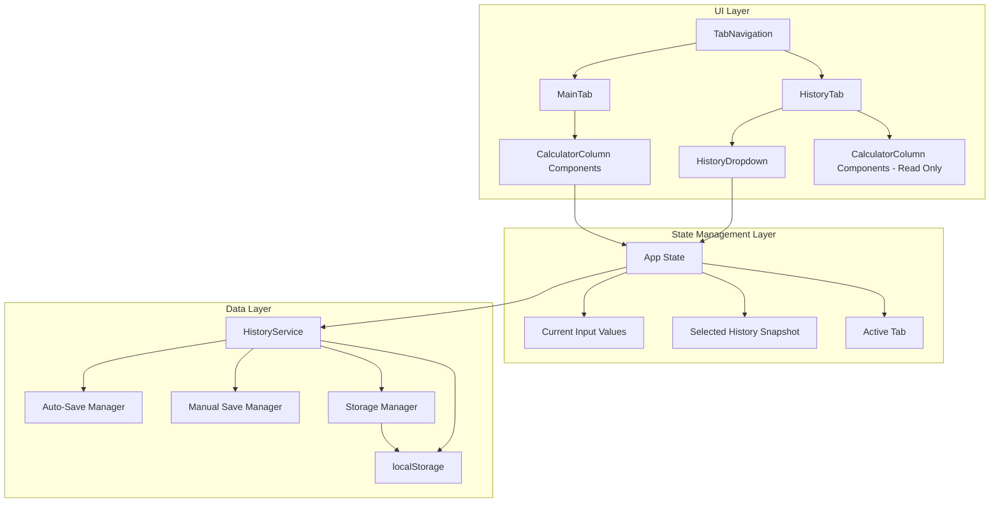

# Data History Design Document

## Overview

The Data History feature extends the existing price calculator application with comprehensive data persistence and historical viewing capabilities. The design leverages React's state management, localStorage for persistence, and a tab-based navigation system while completely reusing existing UI components to maintain visual consistency.

The system implements two types of data saving: automatic saving as users type (for session persistence) and manual saving with timestamps (for creating historical snapshots). Historical data is viewed through a dedicated history tab that uses the same layout and components as the main calculator interface.

## Architecture

The Data History system follows a layered architecture that integrates seamlessly with the existing price calculator:



### Key Architectural Principles

1. **Component Reuse**: All existing UI components (CalculatorColumn, PriceInput, AverageDisplay) are reused without modification
2. **Separation of Concerns**: Data persistence logic is isolated in service classes
3. **State Immutability**: All state updates follow React best practices with immutable updates
4. **Error Resilience**: Graceful handling of localStorage failures and data corruption

## Components and Interfaces

### New Components

#### TabNavigation Component
```typescript
interface TabNavigationProps {
  activeTab: 'main' | 'history';
  onTabChange: (tab: 'main' | 'history') => void;
}
```

Renders tab buttons for switching between main calculator and history view.

#### SaveButton Component
```typescript
interface SaveButtonProps {
  onSave: () => void;
  disabled?: boolean;
}
```

Provides manual save functionality with visual feedback.

#### HistoryDropdown Component
```typescript
interface HistoryDropdownProps {
  snapshots: HistorySnapshot[];
  selectedSnapshotId: string | null;
  onSnapshotSelect: (snapshotId: string) => void;
}
```

Displays list of saved snapshots with formatted date and time for easy identification. Each dropdown option shows both the date (MM/DD/YYYY) and time (HH:MM AM/PM) to help users quickly find the snapshot they want.

#### HistoryTab Component
```typescript
interface HistoryTabProps {
  snapshots: HistorySnapshot[];
  selectedSnapshot: HistorySnapshot | null;
  onSnapshotSelect: (snapshotId: string) => void;
}
```

Container component for the history viewing interface.

### Enhanced App Component

The main App component is extended to support:
- Tab state management
- History data management
- Integration with HistoryService

```typescript
interface AppState {
  inputValues: InputValues;
  activeTab: 'main' | 'history';
  historySnapshots: HistorySnapshot[];
  selectedHistorySnapshot: HistorySnapshot | null;
}
```

## Data Models

### HistorySnapshot
```typescript
interface HistorySnapshot {
  id: string;
  timestamp: number;
  inputValues: InputValues;
  label?: string; // Optional user-defined label
  displayName?: string; // Formatted display name with date/time for dropdown
}
```

### StorageKeys
```typescript
enum StorageKeys {
  AUTO_SAVE = 'price_calculator_auto_save',
  HISTORY_SNAPSHOTS = 'price_calculator_history'
}
```

### HistoryService Interface
```typescript
interface IHistoryService {
  // Auto-save functionality
  autoSave(inputValues: InputValues): void;
  loadAutoSave(): InputValues | null;
  
  // Manual save functionality
  saveSnapshot(inputValues: InputValues, label?: string): HistorySnapshot;
  loadSnapshots(): HistorySnapshot[];
  deleteSnapshot(id: string): void;
  
  // Storage management
  clearAllData(): void;
  getStorageInfo(): { used: number; available: number };
}
```

## Correctness Properties

*A property is a characteristic or behavior that should hold true across all valid executions of a system-essentially, a formal statement about what the system should do. Properties serve as the bridge between human-readable specifications and machine-verifiable correctness guarantees.*

Based on the prework analysis, here are the key correctness properties for the Data History system:

### Property 1: Auto-save persistence
*For any* set of input values, when a user types in any input field, the system should automatically save all current input values to localStorage and be able to restore them on application reload.
**Validates: Requirements 1.1, 1.2, 1.3, 1.4**

### Property 2: Manual save completeness
*For any* current input state, when a user clicks the save button, the system should create a snapshot containing all input field values, a unique identifier, and a timestamp.
**Validates: Requirements 2.1, 2.2, 2.3**

### Property 3: Snapshot accumulation
*For any* sequence of save operations, the system should maintain a complete list of all saved snapshots without losing or corrupting existing data.
**Validates: Requirements 2.4**

### Property 4: UI feedback consistency
*For any* save operation, the system should provide visual feedback and update the UI to reflect the successful save without causing page navigation.
**Validates: Requirements 3.2, 3.3, 3.4**

### Property 5: Component reuse consistency
*For any* historical data display, the system should use the same CalculatorColumn, PriceInput, and AverageDisplay components with identical styling and layout as the main page.
**Validates: Requirements 4.1, 4.3, 6.1, 6.2, 6.3, 6.4, 6.5**

### Property 6: Snapshot loading accuracy
*For any* valid snapshot selected from the dropdown, the system should load that snapshot's input values and automatically calculate the corresponding output values with the same behavior as the main page.
**Validates: Requirements 5.2, 5.3, 5.5**

### Property 7: Dropdown completeness and readability
*For any* set of saved snapshots, the history dropdown should display all snapshots with clearly formatted date and time (MM/DD/YYYY HH:MM AM/PM format) to help users easily identify and select the desired snapshot.
**Validates: Requirements 4.2, 5.1, 5.4**

### Property 8: Tab state preservation
*For any* tab switching operation, the system should preserve the state of both the main tab and history tab independently.
**Validates: Requirements 4.5, 8.4**

### Property 9: Storage mechanism consistency
*For any* storage operation, the system should use localStorage as the primary mechanism and validate data integrity before loading.
**Validates: Requirements 7.1, 7.4**

### Property 10: Tab navigation behavior
*For any* tab selection, the system should display the correct interface (main calculator or history view) and clearly indicate which tab is active.
**Validates: Requirements 8.2, 8.3, 8.5**

<function_calls>
<invoke name="prework">
<parameter name="featureName">data-history

## Error Handling

The Data History system implements comprehensive error handling to ensure robustness:

### localStorage Errors
- **Storage Full**: When localStorage quota is exceeded, the system gracefully degrades by removing oldest snapshots
- **Access Denied**: If localStorage is disabled, the system continues to function without persistence
- **Data Corruption**: Invalid JSON or corrupted data is detected and handled by falling back to default values

### Data Validation
- **Schema Validation**: All loaded data is validated against expected interfaces before use
- **Type Safety**: TypeScript ensures compile-time type safety for all data structures
- **Sanitization**: Input values are sanitized and validated before storage

### UI Error States
- **Empty History**: When no snapshots exist, display helpful empty state message
- **Load Failures**: If snapshot loading fails, show error message and maintain current state
- **Save Failures**: Provide user feedback when save operations fail

### Recovery Mechanisms
- **Graceful Degradation**: Core calculator functionality remains available even if history features fail
- **Data Recovery**: Attempt to recover partial data from corrupted storage
- **Reset Option**: Provide mechanism to clear all history data if corruption is detected

## Testing Strategy

The Data History feature employs a comprehensive dual testing approach combining unit tests and property-based tests to ensure correctness and reliability.

### Property-Based Testing

Property-based tests validate universal properties across all possible inputs using the fast-check library (already configured in the existing project). Each correctness property will be implemented as a property-based test with minimum 100 iterations.

**Property Test Configuration:**
- Library: fast-check (existing project dependency)
- Iterations: 100 minimum per test
- Tag format: **Feature: data-history, Property {number}: {property_text}**

**Key Property Tests:**
1. **Auto-save Round Trip**: For any input values, auto-save then reload should preserve all data
2. **Manual Save Completeness**: For any input state, manual save should create complete snapshots
3. **Component Consistency**: For any historical data, UI components should behave identically to main page
4. **Storage Reliability**: For any valid data, storage and retrieval should be consistent

### Unit Testing

Unit tests focus on specific examples, edge cases, and integration points:

**Component Tests:**
- TabNavigation: Tab switching behavior and active state indication
- SaveButton: Click handling and visual feedback
- HistoryDropdown: Snapshot selection and display formatting
- HistoryTab: Integration with existing calculator components

**Service Tests:**
- HistoryService: CRUD operations for snapshots and auto-save data
- Storage validation and error handling
- Data migration and schema validation

**Integration Tests:**
- End-to-end save and restore workflows
- Tab switching with state preservation
- Error recovery scenarios

**Edge Case Tests:**
- Empty localStorage scenarios
- Corrupted data handling
- Storage quota exceeded
- Invalid snapshot data

### Test Data Generation

Property-based tests will use smart generators that:
- Generate valid InputValues with realistic price ranges
- Create various timestamp scenarios for snapshot testing
- Simulate localStorage states (empty, full, corrupted)
- Generate edge cases for error handling validation

The testing strategy ensures both functional correctness through property-based testing and specific scenario validation through targeted unit tests, providing comprehensive coverage of the Data History feature.